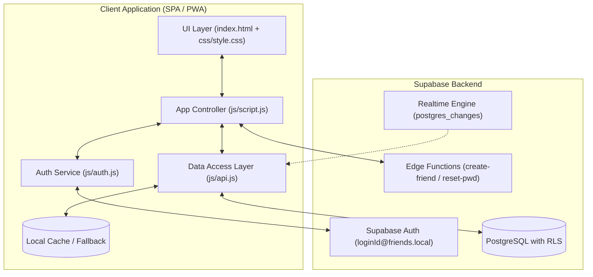

# Friends Expense Manager 🍲

> A modern, transparent, and collaborative expense-splitting web application designed for friends, roommates, and travel groups. Backed by **Supabase** with real authentication, real-time synchronization, Row Level Security (RLS), greedy acyclic settlement optimization, and a full Admin Panel.

---

## 🌟 Key Features

### 🧮 1. Zero-Drift Financial Core & Acyclic Settlements
- **Accurate Balance Formulation**: Every member's global net balance is calculated as:
  $$\text{net}_i = (\text{paid}_i + \text{settled\_sent}_i) - (\text{share}_i + \text{settled\_received}_i)$$
- **Elimination of Phantom Debts**: Suggested settlements are greedily derived directly from global net balances (Debtor $\rightarrow$ Creditor matching), ensuring minimal transfers with **zero circular or phantom debts**.
- **Admin Participation**: The Admin is a full participant who eats, pays, and splits bills like any friend, with real values displayed in dashboard summary cards.

### 🛡️ 2. Supabase Backend & Row Level Security (RLS)
- **Supabase Auth**: Clean "Login ID" experience mapped internally to `<loginId>@friends.local`.
- **Row Level Security**: Every table (`profiles`, `expenses`, `expense_participants`, `settlements`, `settings`, `audit_log`) is locked down with PostgreSQL RLS policies and `SECURITY DEFINER is_admin()` checks.
- **Edge Functions**: Administrative user provisioning (`create-friend`, `reset-password`, `delete-friend`) is executed securely using the Supabase service-role key server-side.
- **Realtime Sync**: Listens to database events via Supabase Realtime so all active participants see expenses and settlements update live across all devices.
- **Offline Resilience**: Falls back to a per-user local cache when the network is unavailable, while showing an explicit "not configured" screen when Supabase credentials are missing.

### 👑 3. Dedicated Admin Panel
- **Member Directory**: Promote/demote admins, deactivate or activate members, reset passwords, or remove members.
- **Group Identity & Budget**: Configure group pot name and global monthly spending threshold.
- **Security & Activity Audit Log**: Detailed logs tracking who created, edited, or deleted expenses and settlements.
- **Danger Zone**: Hard data wipe protected with typed confirmation (`RESET DATA`).

### 📱 4. Friend Portal & Progressive Web App (PWA)
- **Personalized Friend Portal**: View individual balances, who you owe, who owes you, personal expense history, and one-tap settlement confirmations.
- **Installable PWA**: Includes `public/manifest.json` and `public/sw.js` for mobile installation and offline asset caching.
- **Theme Switcher**: Dark and light modes with seamless token switching and local storage persistence.
- **Accessibility & Mobile-First**: WCAG compliant focus trap, accessible custom confirm dialogs replacing `window.confirm`, and verified 360px responsiveness.
- **JSON & CSV Backups**: One-click JSON backup export/import (with schema validation) and CSV export for reporting.

---

## 🏗️ Architecture



---

## 🚀 Quick Start

### Prerequisites
- Node.js (v18 or higher)
- npm or pnpm

### Local Development
```bash
# 1. Clone repository
git clone https://github.com/<your-username>/friends-expense-manager.git
cd friends-expense-manager

# 2. Install dependencies
npm install

# 3. Setup environment variables (optional for local fallback)
cp .env.example .env

# 4. Start Vite development server
npm run dev
```

### Production Build
```bash
npm run build
npm run preview
```

---

## 📖 Deployment to GitHub Pages

The repository includes a preconfigured GitHub Actions workflow in `.github/workflows/deploy.yml`.

1. Push your repository to GitHub.
2. In **Repository Settings** -> **Secrets and variables** -> **Actions**, add:
   - `VITE_SUPABASE_URL`: Your Supabase project URL.
   - `VITE_SUPABASE_ANON_KEY`: Your Supabase anon public API key.
3. In **Repository Settings** -> **Pages**, set **Source** to **GitHub Actions**.
4. The deployment pipeline will automatically build and publish the app!

For full step-by-step instructions on setting up Supabase, database schema, and edge functions, see [SETUP.md](SETUP.md).

---

## 📄 License
MIT © 2026 Friends Expense Manager
