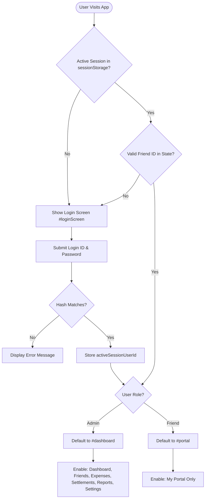
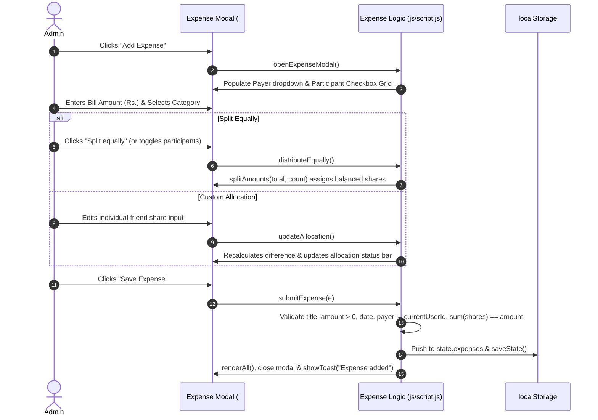
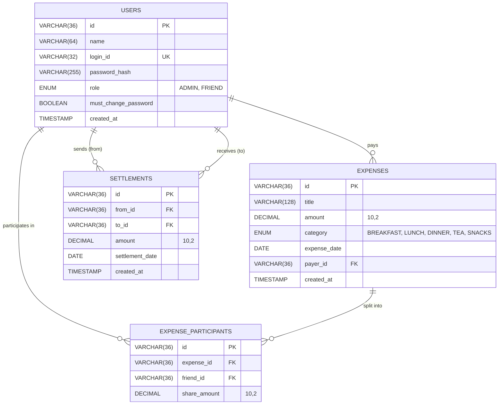
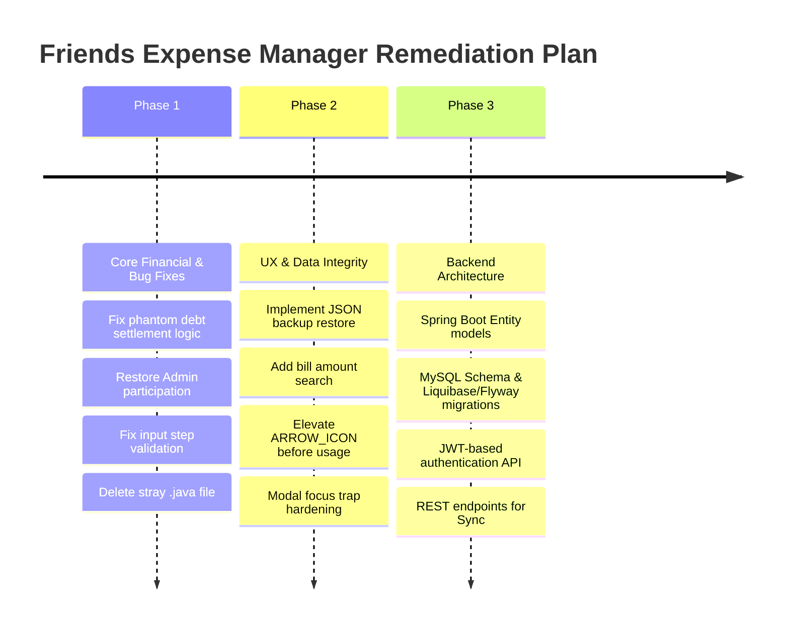

# Friends Expense Manager — System Architecture, Workflow & Error Analysis

A comprehensive technical audit, workflow specification, and vulnerability analysis for the **Friends Expense Manager** web application.

---

## 1. Project Overview & Technology Stack

The **Friends Expense Manager** is a client-side Single Page Application (SPA) designed to manage shared group living and dining expenses (meals, tea, snacks, groceries), calculate pairwise and multilateral balances, and facilitate fair debt settlement.

### Tech Stack
* **Markup:** Semantic HTML5 with ARIA accessibility roles and responsive dialog modals.
* **Styling:** Vanilla CSS3 using custom properties (CSS variables), CSS Grid, Flexbox, conic-gradients for charts, and mobile-first responsive breakpoints.
* **Scripting:** Modern vanilla JavaScript (ES6+), running in strict mode within a single `DOMContentLoaded` closure.
* **Storage & Session:** Browser `localStorage` for state persistence and `sessionStorage` for active user session management.
* **Target Future Backend:** Spring Boot (Java) REST API with MySQL relational database (currently mocked in-browser).

### File Structure
```
friends-expense-manager/
├── index.html              # Core application DOM structure and view panels (1,010 lines)
├── css/
│   └── style.css           # Design tokens, responsive layouts, components, animations (3,843 lines)
├── js/
│   └── script.js           # Business logic, state store, ledger engine, DOM controllers (2,754 lines)
├── assets/
│   └── favicon.svg         # SVG vector brand icon (64x64)
├── .java                   # Stray/corrupt IDE template file (to be removed)
└── workflow.md             # System workflows, error analysis, and technical blueprint (this file)
```

---

## 2. Core Workflows & System Architecture

### 2.1 View Routing & Role-Based Access Control (RBAC)

The application supports two user roles:
1. **Admin (`f-admin`):** Has full access to the Dashboard, Friends list, Expense management, Settlements, Reports, and System Settings.
2. **Friend (`f-xxx`):** Restricted to their personal **My Portal** (`#portal`), showing personal spending stats, balances with other members, pairwise settling actions, and account password management.



---

### 2.2 Expense Creation & Split Distribution Workflow

When creating or modifying an expense, the user specifies the title, category, total amount, payer, date, and individual participant shares.



---

### 2.3 Ledger Calculation & Settlement Workflow

The balance calculation engine processes transactions in two phases:
1. **Direct Pairwise Debt Accumulation:** Reads all `state.expenses` and sums what each participant owes the payer.
2. **Settlement Offsetting:** Subtracts recorded payments (`state.settlements`).
3. **Bilateral Netting:** Nets out mutual debts between any pair $(A \to B)$ and $(B \to A)$.
4. **Multilateral Simplification:** `getSuggestedSettlements()` pairs net debtors with net creditors greedily to minimize overall transactions.

```mermaid
flowchart LR
    subgraph Raw Transactions
        E1[Expenses: Friend Shares]
        S1[Recorded Settlements]
    end

    subgraph Ledger Engine [getLedger]
        D1[Pairwise Debt Matrix: ledger[fromId][toId]]
        S2[Deduct Direct Settlements]
        BN[Bilateral Netting: A owes B vs B owes A]
    end

    subgraph Derived Analytics
        FS[Friend Stats: Total Paid, Share, Net Balance]
        SS[Suggested Settlements: Greedy Debtor-to-Creditor Pairing]
    end

    E1 --> D1
    S1 --> S2
    D1 --> S2 --> BN
    BN --> FS
    FS --> SS
```

---

## 3. Comprehensive Error Analysis & Vulnerability Audit

A line-by-line inspection of the project revealed several critical logical bugs, usability bottlenecks, security limitations, and UI discrepancies.

---

### 3.1 CRITICAL BUGS (Severity: HIGH)

#### Bug 1: Circular "Phantom Debt" Loop in Settlement Reconciliation
* **Location:** [js/script.js#L644-L658](file:///d:/git%20repo/friends-expense-manager/js/script.js#L644-L658) and [js/script.js#L846-L878](file:///d:/git%20repo/friends-expense-manager/js/script.js#L846-L878)
* **Description:**
  `getSuggestedSettlements()` generates **multilateral simplified transfers** (e.g., if Person A owes Person B Rs. 100, and Person B owes Person C Rs. 100, it suggests: *Person A pays Person C Rs. 100*).
  However, in `getLedger()`:
  ```javascript
  state.settlements.forEach((settlement) => {
    let remaining = roundMoney(settlement.amount);
    const direct = roundMoney(ledger[settlement.fromId]?.[settlement.toId] || 0);
    const reduced = Math.min(direct, remaining);
    if (reduced > 0) {
      ledger[settlement.fromId][settlement.toId] = roundMoney(direct - reduced);
      remaining = roundMoney(remaining - reduced);
    }
    if (remaining > 0) {
      addDebt(settlement.toId, settlement.fromId, remaining); // <-- FATAL BUG
    }
  });
  ```
  Because Person A never directly owed Person C (A owed B, and B owed C), `ledger['A']['C']` is 0.
  When the user clicks "Mark paid" on the suggested transfer $A \to C$, `direct` is 0, so `remaining` remains 100.
  Line 656 then executes: `addDebt('C', 'A', 100)`.
* **Impact:**
  Instead of settling the group, **Person C now owes Person A Rs. 100**, while Person A still owes Person B Rs. 100, and Person B still owes Person C Rs. 100. It produces a **circular 3-way perpetual debt loop** where nobody is pairwise settled, and phantom debts appear in Friend histories!
* **Remediation:**
  Settlements are financial balance transfers between entities. In a simplified settlement model, individual net balances must be calculated globally:
  $$\text{Net}(i) = \left(\sum \text{Paid}_i + \sum \text{Settlements Sent}_i\right) - \left(\sum \text{Share}_i + \sum \text{Settlements Received}_i\right)$$
  When recording a settlement between $A \to B$ that exceeds or exists outside direct pairwise debt, it should either reduce transitive pairwise debts along the debt graph or suggested settlements should offer direct pairwise options.

---

#### Bug 2: Forced Exclusion of Admin from Expense Participation & Balances
* **Location:** [js/script.js#L198-L224](file:///d:/git%20repo/friends-expense-manager/js/script.js#L198-L224), [js/script.js#L477-L479](file:///d:/git%20repo/friends-expense-manager/js/script.js#L477-L479), [js/script.js#L2209](file:///d:/git%20repo/friends-expense-manager/js/script.js#L2209)
* **Description:**
  1. `sanitizeAdminData` executes on every state load and actively strips `data.currentUserId` (Admin) from all expenses (both as payer and participant) and purges all settlements involving Admin.
  2. `getGroupFriends()` explicitly excludes the admin:
     ```javascript
     function getGroupFriends() {
       return state.friends.filter((friend) => friend.id !== state.currentUserId);
     }
     ```
  3. `submitExpense` rejects Admin as payer:
     ```javascript
     if (!getFriend(payerId) || payerId === state.currentUserId)
     ```
  4. Yet `renderDashboard` binds the stat cards to the Admin's balance:
     ```javascript
     setStatValue(statReceive, balances.receives); // Always 0
     setStatValue(statOwe, balances.owes);         // Always 0
     ```
* **Impact:**
  In a real-world friends group, the admin is usually one of the friends eating meals and paying bills. Under the current code, the Admin cannot log an expense they paid for, cannot be included in any split, and the "You Should Receive" and "You Owe" summary cards on the Dashboard are permanently stuck at **Rs. 0**.
* **Remediation:**
  Treat Admin as a regular participant in group expenses while preserving administrative privileges (settings, resets, removals). Remove `sanitizeAdminData` and allow `currentUserId` to pay and participate in splits.

---

### 3.2 MEDIUM & FUNCTIONAL BUGS (Severity: MEDIUM)

#### Bug 3: Input Step Attribute Prevents Decimal / Fractional Expense Amounts
* **Location:** [index.html#L870](file:///d:/git%20repo/friends-expense-manager/index.html#L870) and [index.html#L726](file:///d:/git%20repo/friends-expense-manager/index.html#L726)
* **Description:**
  The total expense input is configured as:
  ```html
  <input type="number" id="expenseAmount" name="amount" placeholder="0" min="0" step="1" inputmode="numeric" required>
  ```
  While participant share inputs have `step="0.01"`, `expenseAmount` has `step="1"`.
* **Impact:**
  If an expense has decimals (e.g. `Rs. 450.50`), native HTML5 form constraint validation triggers a `stepMismatch` error ("Please enter a valid value"), blocking form submission. Additionally, `settingsBudget` has `step="100"`, rejecting budgets like `Rs. 25,500` or `Rs. 1,250`.
* **Remediation:**
  Change `step="1"` to `step="any"` or `step="0.01"` on `#expenseAmount`, and `step="any"` on `#settingsBudget`.

---

#### Bug 4: Asymmetric Data Backup (Export JSON Exists, Import JSON Missing)
* **Location:** [index.html#L790-L817](file:///d:/git%20repo/friends-expense-manager/index.html#L790-L817) and [js/script.js#L2498-L2514](file:///d:/git%20repo/friends-expense-manager/js/script.js#L2498-L2514)
* **Description:**
  The Settings tab provides an "Export data" button (`exportJson`) that downloads `friends-expense-manager-YYYY-MM-DD.json` and a "Clear all data" button (`resetData`). However, there is no file upload or JSON import mechanism anywhere in the UI.
* **Impact:**
  If a user clears their browser cache, resets data, or moves to another device, they cannot restore their backup file without manually running script commands in the developer console.
* **Remediation:**
  Add an "Import backup" file input button in Settings that parses, validates the JSON schema, and calls `saveState()` + `renderAll()`.

---

#### Bug 5: Temporal Dead Zone / Hoisting Vulnerability with `ARROW_ICON`
* **Location:** [js/script.js#L832](file:///d:/git%20repo/friends-expense-manager/js/script.js#L832) and [js/script.js#L924](file:///d:/git%20repo/friends-expense-manager/js/script.js#L924)
* **Description:**
  `getFriendLedger` references `ARROW_ICON` at line 832, but `const ARROW_ICON = ...` is declared at line 924.
* **Impact:**
  `const` declarations are block-scoped and not hoisted. Although currently `getFriendLedger` is only called during rendering (after script execution passes line 924), any early execution during initialization or testing will immediately throw an uncatchable `ReferenceError: Cannot access 'ARROW_ICON' before initialization`.
* **Remediation:**
  Move `ARROW_ICON` and other SVG constants to the top Configuration section (around line 20).

---

#### Bug 6: Timezone & Date Comparison Skew in Notifications
* **Location:** [js/script.js#L1627](file:///d:/git%20repo/friends-expense-manager/js/script.js#L1627) and [js/script.js#L1634](file:///d:/git%20repo/friends-expense-manager/js/script.js#L1634)
* **Description:**
  Fallback notification timestamps use `${expense.date}T12:00:00` (without UTC `Z` offset), whereas `notificationsReadAt` and actual `createdAt` values are generated via `new Date().toISOString()` (in UTC with `Z`).
* **Impact:**
  String comparison:
  ```javascript
  const isUnread = !readAt || String(event.createdAt) > String(readAt);
  ```
  lexicographically compares mixed UTC and local strings. Notifications can prematurely mark as read or stay permanently unread depending on the user's timezone.
* **Remediation:**
  Ensure fallback timestamps are formatted with standard UTC ISO format (e.g., `${expense.date}T12:00:00.000Z`).

---

### 3.3 LOW SEVERITY & CODE QUALITY ISSUES (Severity: LOW)

#### Bug 7: Stray Corrupted File `.java` in Project Root
* **Location:** [/.java](file:///d:/git%20repo/friends-expense-manager/.java)
* **Description:**
  Contains 59 bytes of incomplete boilerplate:
  ```java
  package io.github.jiangdequan;

  public @interface  {
      
  }
  ```
* **Impact:** Unnecessary clutter, invalid syntax, and confusion for automated build tools.
* **Remediation:** Delete the `.java` file.

---

#### Bug 8: Expense Search Does Not Match Bill Amounts
* **Location:** [js/script.js#L1409-L1417](file:///d:/git%20repo/friends-expense-manager/js/script.js#L1409-L1417)
* **Description:**
  The `haystack` string in `renderExpensesPage` includes title, payer name, category label, and participant names, but omits `expense.amount`.
* **Impact:** Searching for a specific bill amount (e.g., "1200" or "450") returns zero results.
* **Remediation:** Add `String(expense.amount)` and `formatMoney(expense.amount)` to `haystack`.

---

#### Bug 9: Modal Focus Trap Escape
* **Location:** [js/script.js#L1974-L1994](file:///d:/git%20repo/friends-expense-manager/js/script.js#L1974-L1994)
* **Description:**
  `trapFocus` checks whether `document.activeElement` is `first` or `last`. If focus starts outside the modal before keyboard tabbing commences, focus is not constrained and leaks into background DOM elements.
* **Remediation:** Check `if (!modal.contains(document.activeElement)) { first.focus(); event.preventDefault(); }`.

---

#### Bug 10: Inaccessible Active Members Subtitle in Reports
* **Location:** [js/script.js#L1543-L1545](file:///d:/git%20repo/friends-expense-manager/js/script.js#L1543-L1545) and [index.html#L667-L668](file:///d:/git%20repo/friends-expense-manager/index.html#L667-L668)
* **Description:**
  The dynamic text `${activeFriends} of ${state.friends.length - 1} friends have shared expenses` is injected into the HTML `title` attribute of `#reportActiveFriends` instead of updating the subtitle element below it.
* **Impact:** On mobile/touch devices, hover tooltips do not exist, rendering this information inaccessible.
* **Remediation:** Add an ID (`id="reportActiveFriendsHint"`) to the hint `<p>` in `index.html` and update its `textContent`.

---

## 4. Entity-Relationship & Data Model Specification

To facilitate the planned migration to **Spring Boot + MySQL**, the following relational database schema is required:



---

## 5. Step-by-Step Remediation Roadmap



### Phase 1: Core Financial Fixes (Immediate)
1. **Fix Settlement Netting:** Refactor `getLedger()` and `recordSettlement()` to prevent phantom debt loops when multilateral settlements are recorded.
2. **Restore Admin Participation:** Remove `sanitizeAdminData()` and allow Admin to be chosen as payer and participant in shared expenses.
3. **Correct Input Constraints:** Update `index.html` inputs for `#expenseAmount` and `#settingsBudget` to `step="any"`.
4. **Clean Workspace:** Delete `.java`.

### Phase 2: UX & Feature Enhancements (Short-term)
1. **Implement JSON Import:** Add file selector in Settings to load and validate exported backups.
2. **Enhanced Search:** Include amount and formatted money in expense search.
3. **Accessibility Hardening:** Bind report active member stats to visible text and fix modal focus traps.

### Phase 3: Spring Boot & MySQL Migration (Long-term)
1. Build Spring Boot controller endpoints (`/api/v1/expenses`, `/api/v1/settlements`, `/api/v1/friends`).
2. Replace `localStorage` with `fetch()` API calls with offline fallback.
3. Replace custom FNV hash with industry-standard BCrypt / Argon2 on the server.
